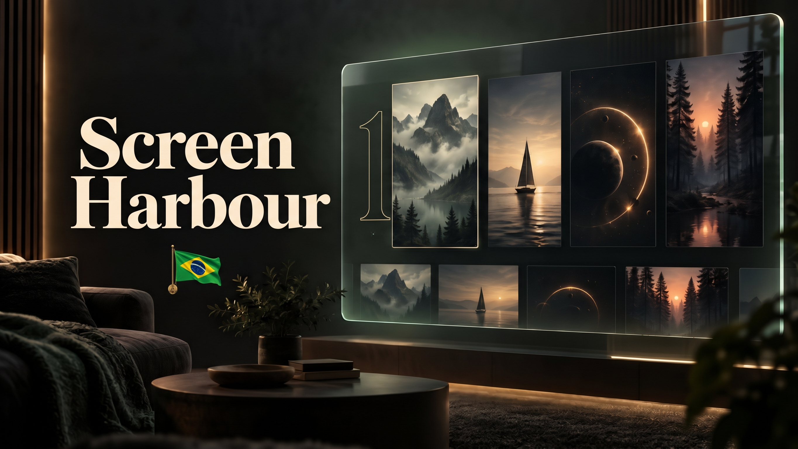

# ScreenHarbour (Edição Brasil)

**Uma interface cinematográfica premium para Jellyfin, 100% localizada em português e feita para o público brasileiro.**

[](https://github.com/Shillooh/HabourBRVer)
[](https://jellyfin.org)
[](README.md)
[](LICENSE.md)



> [!NOTE]
> **Hard Fork Independente:** O **ScreenHarbour Brasil** é um hard fork independente do projeto original *ScreenHarbour* (anteriormente *Jellyfin Cinema* e *TV Item Layout* por *jampez77*), mantido e evoluído por **[Shillooh](https://github.com/Shillooh/HabourBRVer)** com foco total no público brasileiro, streaming nacional e automação sem configurações manuais cansativas.

---

## 🌟 O que há de novo na Edição Brasil?

O ScreenHarbour Brasil transforma o Jellyfin em uma central cinematográfica moderna e intuitiva nos modos **TV** (com controle remoto/D-pad) e **Desktop** (mouse e teclado).

### 🚀 1. Fileiras "Em Alta" 100% Dinâmicas via TMDB (Sem Coleções Manuais!)
No projeto original e em outros temas do Jellyfin, para ter fileiras como "Em Alta na Netflix" ou "Top Filmes de Hoje", o administrador precisava instalar plugins complexos como *SmartLists* ou integrar listas externas do *MDBList* e *Trakt*.
* **Automação Nativa no Servidor:** O ScreenHarbour Brasil consulta diretamente a API oficial do **TMDB** (`language=pt-BR`, `region=BR`) todos os dias para identificar as produções em alta no Brasil.
* **Cruzamento Instantâneo com sua Biblioteca:** O plugin cruza a lista do TMDB com o acervo existente no seu servidor Jellyfin. Se você tem o filme ou série, ele entra instantaneamente na fileira de "Em Alta", com numeração visual de ranking (1 a 10), **sem precisar criar nenhuma coleção manual!**

### 🇧🇷 2. Presets Nacionais de Streaming e Provedores
A lista de serviços de streaming foi totalmente reestruturada para o mercado nacional:
* **Provedores Nacionais e Internacionais:** Telas dedicadas e logotipos em alta resolução para **Globoplay**, **Max**, **Prime Video**, **Netflix**, **Brasil Paralelo**, **Disney+**, **Paramount+**, **Discovery+** e **Rakuten Viki**.
* **Disponibilidade Brasil:** Os filtros automáticos de catálogo verificam ofertas válidas no Brasil (`Region=BR`).
* Suporte completo para adicionar seus próprios serviços personalizados nas configurações.

### 🇧🇷 3. Localização 100% em Português do Brasil (pt-BR)
* Menus, preferências, telas de configuração, filtros, notificações, status de reprodução e botões traduzidos com linguagem natural e adaptada ao Brasil.
* Sem termos em inglês ou resíduos do catálogo britânico do fork original.

### 🖱️ 4. Navegação Aperfeiçoada & Rolagem por Arraste (Drag-Scroll)
* **Botões de Rolagem (Chevrons):** Setas elegantes nas extremidades das fileiras para rolagem rápida no mouse.
* **Arrastar e Soltar:** Suporte total a arrastar com o mouse ou toque para rolar carrosséis de mídia de forma ultra suave.
* **Restauração Perfeita de Posição:** Ao assistir a um trailer ou abrir os detalhes de um filme e voltar, o foco e a posição exata da tela são preservados instantaneamente.

---

## 📸 Recursos em Destaque

| Recurso | Descrição |
| --- | --- |
| **Página Inicial Cinematográfica** | Pôsteres estilizados, banners com gradientes imersivos, fileiras ordenadas e suporte integrado ao plugin Jellyfin Featured. |
| **Hubs de Streaming** | Páginas exclusivas para cada plataforma (Globoplay, Netflix, Prime Video, Max, etc.) destacando o acervo do seu servidor pertencente a cada serviço. |
| **Guia de TV ao Vivo Horizontal** | Grade de programação horizontal moderna para IPTV/TV ao vivo com proporções visuais elegantes e navegação por controle remoto. |
| **Navegação In-Player** | Durante a reprodução de um vídeo, pressione a tecla "Para Baixo" ou clique no ícone de navegação para alternar episódios ou ver títulos recomendados sem parar o vídeo. |
| **Tela de Pausa Personalizada** | Ao pausar, veja logo do título, sinopse, progresso e a estimativa de término (*Termina às hh:mm*). |
| **Telas de Carregamento** | Escolha entre animações clássicas: Projetor de cinema, Claquete, Rolo de filme, Contagem regressiva, Holofotes ou o logo do Jellyfin. |
| **Grupos Sazonais** | Decorações e portas de calendário temáticas para **Halloween** e **Natal** (com desbloqueio diário estilo Calendário do Advento). |

---

## 📦 Como Instalar no Jellyfin

### 1. Adicionar o Repositório do Plugin
1. Abra o painel administrativo do seu Jellyfin: **Painel de Controle** → **Plugins** → aba **Repositórios**.
2. Clique no botão **`+`** (Adicionar) e preencha:
   * **Nome do Repositório:** `ScreenHarbour Brasil`
   * **URL do Repositório:**
     ```text
     https://raw.githubusercontent.com/Shillooh/HabourBRVer/main/manifest.json
     ```
3. *(Obrigatório)* Certifique-se de ter também o repositório do plugin **File Transformation** adicionado:
   * **URL:** `https://www.iamparadox.dev/jellyfin/plugins/manifest.json`

### 2. Instalar os Plugins
1. Vá até a aba **Catálogo** no Jellyfin.
2. Localize e instale o **ScreenHarbour Brasil** (o Jellyfin selecionará automaticamente a versão adequada para o seu servidor: `1.0.0.3` para v12, `1.0.0.2` para v10.11 ou `1.0.0.1` para v10.10).
3. Instale também o plugin **File Transformation**.
4. **Reinicie o servidor Jellyfin**.

### 3. Ativar a Interface
1. No seu navegador ou aplicativo web de TV, acesse as **Configurações do Usuário** → **Exibição**.
2. Defina o **Modo de Exibição** para **Área de Trabalho (Desktop)** ou **TV**.
3. Recarregue a página (`F5` ou reabra o app na TV) para desfrutar da nova experiência cinematográfica!

> [!TIP]
> Caso já tivesse instalado o plugin original (*TV Item Layout* ou *Jellyfin Cinema*), basta atualizar o repositório no Painel para o link do ScreenHarbour Brasil e realizar a atualização. Todas as suas configurações e GUIDs serão preservados.

---

## 🛠️ Compatibilidade de Versões

O Jellyfin gerencia a compatibilidade de plugins pelo **Target ABI** e runtime do .NET. O repositório seleciona automaticamente a compilação exata para o seu servidor:

| Versão do Jellyfin | Versão do Plugin | Target ABI | Target Framework | Pacote Gerado |
| :---: | :---: | :---: | :---: | :---: |
| **12.x / 12.0.0+** | `1.0.0.3` | `12.0.0` | .NET 10.0 | `TvItemLayout_1.0.0.3_jellyfin-12.0.0.zip` |
| **10.11.x** | `1.0.0.2` | `10.11.0` | .NET 9.0 | `TvItemLayout_1.0.0.2_jellyfin-10.11.0.zip` |
| **10.10.x / 10.10.7** | `1.0.0.1` | `10.10.7` | .NET 8.0 | `TvItemLayout_1.0.0.1_jellyfin-10.10.7.zip` |

> [!NOTE]
> Ao instalar pelo catálogo oficial do repositório, o Jellyfin detecta a versão do seu servidor e seleciona automaticamente o pacote correspondente (`1.0.0.3` para v12, `1.0.0.2` para v10.11 ou `1.0.0.1` para v10.10), garantindo compatibilidade total sem erros de `NotSupported`.

---

## 💻 Desenvolvimento e Compilação Local

Para desenvolvedores que queiram testar ou criar novas funcionalidades localmente:

### Requisitos
* [Node.js](https://nodejs.org) (v18+)
* [.NET SDK](https://dotnet.microsoft.com/download) (versão correspondente ao seu Jellyfin)

### Passo a Passo

```bash
# 1. Clone o repositório
git clone https://github.com/Shillooh/HabourBRVer.git
cd HabourBRVer

# 2. Instale as dependências
npm ci

# 3. Compile a biblioteca cliente TypeScript/CSS
npm run build

# 4. Inicie o servidor de desenvolvimento / demo interativo
npm run dev

# 5. Execute os testes unitários e validações de tipo
npm run typecheck
npm test

# 6. Empacote o plugin do servidor C# (todas as versões)
bash scripts/package-plugin.sh all
```

---

## 📂 Estrutura do Código

```
├── assets/                     # Ícones, fontes sazonais e logotipos dos provedores (Globoplay, Max, etc.)
├── demo/                       # Ambiente de demonstração independente e dados fictícios
├── scripts/                    # Scripts de build, empacotamento e geração de manifestos
├── server/                     # Código do Plugin em C# (.NET)
│   ├── Api/                    # Controladores da API REST do plugin
│   └── Providers/              # Integração TMDB Brasil (Region=BR), cache e provedores
├── src/                        # Código-fonte do cliente Web (TypeScript e CSS)
│   ├── home-collections.ts     # Gerenciamento de fileiras na tela inicial
│   ├── home-row-scroll.ts      # Controle de scroll, chevrons e drag scrolling
│   ├── provider-brands.ts      # Metadados e marcas dos serviços de streaming brasileiros
│   ├── provider-data.ts        # Lógica de integração e exibição dos catálogos
│   └── ...                     # Visualizações de TV ao vivo, player, navegação, perfis
└── tests/                      # Suite de testes unitários e de integração
```

---

## ⚖️ Créditos e Agradecimentos

* **Mantenedor & Hard Fork Brasil:** [Shillooh](https://github.com/Shillooh/HabourBRVer).
* **Projeto Original:** Agradecimento especial a [jampez77](https://github.com/jampez77) pela base de código do *ScreenHarbour* / *TV Item Layout* / *Jellyfin Cinema*.
* **In-Player Episode Preview:** Padrões de reprodução inspirados em [jampez77/InPlayerEpisodePreview-TV](https://github.com/jampez77/InPlayerEpisodePreview-TV) e [Namo2/InPlayerEpisodePreview](https://github.com/Namo2/InPlayerEpisodePreview).
* **Metadados e Imagens:** Este produto utiliza a API do [The Movie Database (TMDB)](https://www.themoviedb.org/), mas não é endossado ou certificado pelo TMDB.
* **Marcas Registradas:** Todos os logotipos de serviços de streaming (Globoplay, Netflix, Max, Prime Video, Disney+, etc.) pertencem aos seus respectivos proprietários e são utilizados unicamente para identificação dos catálogos.
* **Licença:** Distribuído sob a licença **MIT**. Consulte o arquivo [LICENSE.md](LICENSE.md) para mais detalhes.
